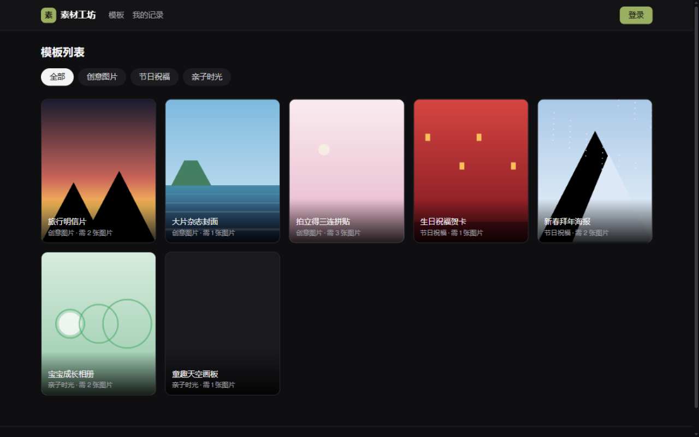
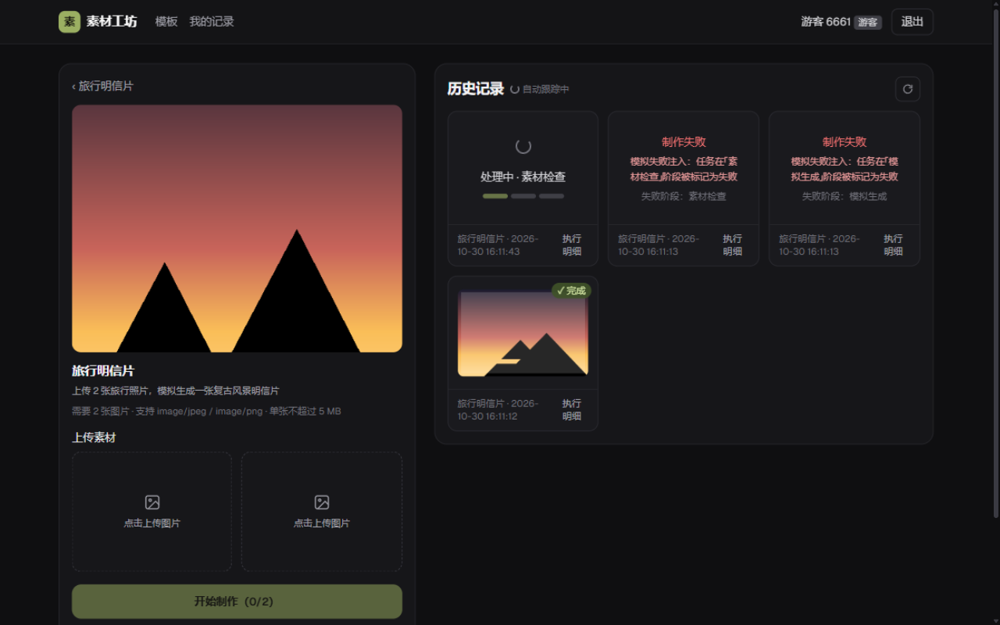
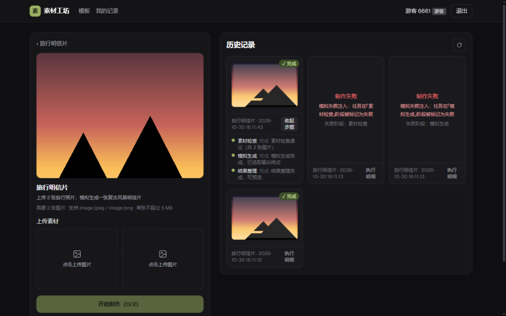
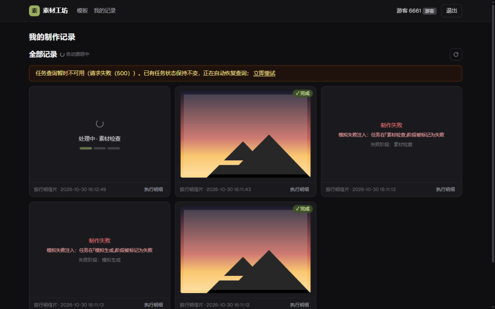

# 素材工坊 · 全栈开发笔试题交付

一个可独立运行的素材制作网站：浏览模板 → 上传图片 → 提交制作任务 → 后台异步处理（可控制耗时与成功/失败的模拟生成器）→ 查看历史记录与制作结果。

| 模板列表 | 详情与制作（处理中/失败/成功并存） |
|---|---|
|  |  |
| **执行明细（分步边界）** | **后端停机时：查询异常 ≠ 任务失败** |
|  |  |

> 题目原文见 [docs/exam-requirements.md](docs/exam-requirements.md)；参考截图见 [docs/ui-reference/](docs/ui-reference/)；以上为运行实测截图，更多见 [docs/screenshots/](docs/screenshots/)。
>
> 交付仓库以 tag **`acceptance`** 标注验收 commit。

## 一、技术版本

| 层 | 技术 | 版本 |
|---|---|---|
| 前端 | Next.js（App Router） | 14.2.35 |
| 前端 | React / TypeScript | 18.3.x / 5.x |
| 前端样式 | Tailwind CSS | 3.4.x |
| 前端状态 | zustand | 5.0.x |
| 前端测试 | Vitest + Testing Library | 2.1.x / 16.x |
| 后端 | Java | 17 |
| 后端 | Spring Boot | 3.3.12 |
| 后端 | MyBatis（mybatis-spring-boot-starter） | 3.0.4 |
| 数据库 | MySQL | 8.0 |
| 后端测试 | JUnit5 + MockMvc + H2（MySQL 兼容模式）+ Awaitility | — |
| 构建 | Maven / npm（含锁文件 package-lock.json） | — |
| 部署 | Docker Compose（mysql + backend + frontend） | — |

## 二、项目结构

```
xiaoying-ra/
├── backend/                    # Java 后端（Spring Boot + MyBatis）
│   └── src/main/java/com/xiaoying/ra/
│       ├── auth/               # 注册/登录/游客/会话（token 落库）
│       ├── template/           # 模板接口 + 种子数据
│       ├── asset/              # 素材上传/校验/存储
│       ├── task/               # 任务受理、三步异步执行、状态落库、失败注入、启动清扫
│       ├── common/             # 统一异常、参数解析
│       └── config/             # Web/异步线程池配置
├── frontend/                   # Next.js 前端
│   └── src/
│       ├── app/                # 模板列表 / 模板详情 / 我的记录 / 登录
│       ├── components/         # 上传位、历史卡片、历史面板、头导航等
│       ├── lib/                # api 封装、taskStore（轮询核心）、authStore、类型
│       ├── middleware.ts       # 运行时反向代理 /api、/demo、/files → Java 后端
│       └── tests/              # vitest 测试
├── docs/                       # 题目、UI 参考截图、样例上传图片
├── scripts/                    # generate-images.mjs（示例图片生成）、api-e2e.mjs（接口自测脚本）
├── docker-compose.yml          # 一键启动 mysql/backend/frontend
└── .github/workflows/ci.yml    # CI：前端 lint+tsc+test+build；后端 test+package
```

## 三、构建 / 测试 / 启动

### 方式 A：Docker Compose（推荐）

```bash
docker compose up --build
# 首次构建约 3-8 分钟（内置健康检查链：mysql → backend → frontend）
# 完成后：
#   前端：http://localhost:3000
#   后端：http://localhost:8080（接口文档 http://localhost:8080/swagger-ui.html）
#   MySQL：localhost:3306（账号 xiaoying / xiaoying123，仅本地调试用）
```

停止：`docker compose down`（加 `-v` 同时清空数据卷）。

### 方式 B：本地分开启动

前置：JDK 17、Maven 3.8+、Node 20、本地 MySQL 8（或用 compose 单独起 mysql：`docker compose up -d mysql`）。

```bash
# 1) 数据库初始化：后端启动时自动执行 schema.sql（全部 IF NOT EXISTS，可重复执行），
#    模板种子数据由 TemplateSeeder 在表为空时自动写入，无需手工导入。

# 2) 后端（在 backend/ 目录）
mvn spring-boot:run          # 或 mvn package 后 java -jar target/xiaoying-ra-backend.jar
# 连接本地 MySQL 的默认参数：localhost:3306/xiaoying_ra，用户 xiaoying / xiaoying123
# 可用环境变量覆盖：DB_HOST DB_PORT DB_NAME DB_USER DB_PASSWORD UPLOAD_DIR

# 3) 前端（在 frontend/ 目录）
npm ci
npm run dev                  # http://localhost:3000；默认代理后端 http://localhost:8080
```

### 测试与静态检查

```bash
# 后端（H2 内存库，无需 MySQL）
cd backend && mvn test

# 前端
cd frontend && npm test        # vitest
npm run lint                   # eslint
npx tsc --noEmit               # 类型检查
npm run build                  # 生产构建
```

### 前后端与数据库如何连接

- 浏览器只访问前端（3000）。前端通过 **`src/middleware.ts` 运行时反向代理**把 `/api/*`、`/demo/*`、`/files/*` 转发到后端（容器内 `BACKEND_ORIGIN=http://backend:8080`，本地默认 `http://localhost:8080`），浏览器与前端同源，无跨域问题；代理目标在运行时读取环境变量，改配置无需重新构建。
- 后端（8080）通过 JDBC 连接 MySQL：连接串、账号见 `backend/src/main/resources/application.yml`，全部支持环境变量覆盖。
- 上传文件保存在后端本地目录（容器内 `/data/uploads`，数据卷 `uploads`），由后端以 `/files/**` 提供访问；模板封面与模拟结果图打包在 jar 内 `/demo/**`。

## 四、配置项说明

| 环境变量 | 默认值 | 说明 |
|---|---|---|
| `DB_HOST` / `DB_PORT` / `DB_NAME` | `localhost` / `3306` / `xiaoying_ra` | MySQL 连接 |
| `DB_USER` / `DB_PASSWORD` | `xiaoying` / `xiaoying123` | compose 中由 mysql 服务自动创建 |
| `UPLOAD_DIR` | `./data/uploads` | 素材保存目录 |
| `TOKEN_TTL_HOURS` | `72` | 登录会话有效期 |
| `SIM_ASSET_CHECK_MS` / `SIM_GENERATE_MS` / `SIM_FINALIZE_MS` | `4000` / `8000` / `4000` | 三步模拟耗时（毫秒，运行中也可调，见下） |
| `SIM_FAIL_STAGE` | `NONE` | 全局失败注入：`NONE`/`ASSET_CHECK`/`GENERATE`/`FINALIZE` |
| `SIM_DEV_API` | `false`（compose 演示环境为 `true`） | 是否暴露 `/api/dev/simulation` 调参接口（不要求登录，仅演示用） |
| `SWAGGER_ENABLED` | `true` | 是否启用 OpenAPI 文档（`/swagger-ui.html`），生产环境可关闭 |
| `BACKEND_ORIGIN`（前端） | `http://localhost:8080` | 运行时代理目标（`src/middleware.ts`） |

数据库初始化与模拟数据准备：全部自动化（schema.sql + TemplateSeeder + 打包图片），无需手工步骤。样例上传图片在 `docs/sample-uploads/`，可直接用于页面上传演示。

## 五、任务状态、阶段与后台执行方式

- **任务状态（t_task.status）**：`PENDING`（等待处理）→ `PROCESSING`（处理中）→ `SUCCESS` / `FAILED`（终态，不可逆）。
- **阶段（t_task.stage）**：`ASSET_CHECK` 素材检查 → `GENERATE` 模拟生成 → `FINALIZE` 结果整理。整体状态与当前阶段分开存储。
- **分步记录（t_task_step）**：每步一条记录，含独立的状态（PENDING/RUNNING/SUCCESS/FAILED）、开始/结束时间与结果消息，接口可查询（详情页"执行明细"）。
- **执行方式**：提交接口完成参数校验、创建任务与 3 条步骤记录、绑定素材后**立即返回任务 ID**；实际执行由 `TaskRunner` 在独立线程池（core 3 / max 5 / queue 100）中异步进行。每一步先把步骤与任务标记为 RUNNING，再按配置耗时 sleep，随后写回结果；每步执行前后状态均持久化到 MySQL，**查询接口只读状态，不推进任务**。
- **失败**：某一步失败（注入或真实异常）后立即停止，不执行后续步骤；任务记录失败阶段与可读原因，未执行的步骤保持 PENDING。完成后任务不会因查询变回处理中。
- **重启语义**：服务重启时 `RestartSweeper` 把遗留的 PENDING/PROCESSING 任务标记为 FAILED（原因："服务重启导致任务中断，请重新提交（未实现断点恢复）"），避免前端无限轮询。断点续跑不在本期范围（见第九节）。

## 六、主要接口

除注明外均需 `Authorization: Bearer <token>`；错误响应统一为 `{"message": "..."}` + 对应 4xx/5xx 状态码。

| 方法/路径 | 说明 | 请求 / 响应要点 |
|---|---|---|
| `POST /api/auth/register` | 注册 | `{username, password, displayName?}` → `{token, user}` |
| `POST /api/auth/login` | 登录 | `{username, password}` → `{token, user}` |
| `POST /api/auth/guest` | 一键游客 | 无 body → `{token, user}` |
| `POST /api/auth/logout` | 登出 | 204，服务端删除会话 |
| `GET /api/auth/me` | 当前用户 | → `UserView` |
| `GET /api/templates` | 模板列表 | `?category=` 过滤 → `{templates: TemplateView[]}` |
| `GET /api/templates/categories` | 分类 | → `{categories: string[]}` |
| `GET /api/templates/{id}` | 模板详情 | → `TemplateView`（含 requiredImageCount / acceptedMimeTypes / maxFileSizeBytes） |
| `POST /api/assets` | 上传素材 | multipart：`templateId` + `file` → `AssetView{id, originalName, mimeType, sizeBytes, url}` |
| `DELETE /api/assets/{id}` | 移除素材 | 204；已被任务使用的素材返回 409 |
| `POST /api/tasks` | 提交任务 | `{templateId, assetIds[], failStage?}` → 201 `{task, steps}`，立即返回 |
| `GET /api/tasks` | 历史/批量查询 | `?ids=a,b,c`（轮询用）/ `?templateId=` → `{tasks: TaskView[]}` |
| `GET /api/tasks/{id}` | 任务详情 | → `{task, steps}`（分步执行明细） |
| `GET/PUT /api/dev/simulation` | 模拟调参 | GET 查看当前配置；PUT `{failStage?, durations?{assetCheckMs, generateMs, finalizeMs}}` |

`TemplateView`：`{id, title, category, description, coverUrl, requiredImageCount, acceptedMimeTypes, maxFileSizeBytes}`
`TaskView`：`{id, templateId, templateTitle, status, stage, failureReason, resultUrl, createdAt, startedAt, finishedAt}`
`StepView`：`{step, status, message, startedAt, finishedAt}`

## 七、功能演示

**准备**：打开 http://localhost:3000 → 右上角"登录" → "一键游客登录"（或注册账号）。

### 1) 正常成功流程
1. 模板列表页切换分类（创意图片 / 节日祝福 / 亲子时光），点击卡片进详情。
2. 在"上传素材"区上传 `docs/sample-uploads/` 里的图片（数量按模板要求：如旅行明信片需 2 张）。
3. 点击"开始制作"→ 按钮短暂"提交中"后即恢复可用；右侧出现新任务卡片"等待处理…"。
4. 卡片自动变为"处理中 · 素材检查/模拟生成/结果整理"（带阶段进度条）；默认总耗时约 16 秒后显示"✓ 完成"与结果图。可点"执行明细"查看三步的状态与消息。

### 2) 指定阶段失败（两种方式）

先拿到一个可用 token（供脚本演示）：

```bash
TOKEN=$(curl -s -X POST http://localhost:3000/api/auth/guest | sed 's/.*"token":"\([^"]*\)".*/\1/')
echo $TOKEN
```

- **全局注入（对之后所有新任务生效）**：
  ```bash
  curl -X PUT http://localhost:8080/api/dev/simulation \
    -H "Content-Type: application/json" -d '{"failStage":"GENERATE"}'
  # 恢复：{"failStage":"NONE"}
  ```
- **单任务注入（可重复、精确控制，便于同一页面同时演示成功+失败）**：提交请求带字段即可（前端页面不使用该字段，专供接口/脚本演示）：
  ```bash
  # 取 token 与 assetIds 后：
  curl -X POST http://localhost:8080/api/tasks \
    -H "Authorization: Bearer $TOKEN" -H "Content-Type: application/json" \
    -d '{"templateId":"demo-magazine","assetIds":[1],"failStage":"FINALIZE"}'
  ```
- 观察点：卡片显示"制作失败"+ 原因（如"模拟失败注入：任务在「模拟生成」阶段被标记为失败"）与失败阶段；"执行明细"中该步 FAILED，后续步骤保持"等待"。

### 3) 调整处理耗时
```bash
# 把三步改为 2s/3s/2s，便于快速观察；也可拉长观察多任务排队
curl -X PUT http://localhost:8080/api/dev/simulation \
  -H "Content-Type: application/json" \
  -d '{"durations":{"assetCheckMs":2000,"generateMs":3000,"finalizeMs":2000}}'
```
（同样可用环境变量 `SIM_*` 在启动时设置。）

### 4) 多任务并行与互不串扰
- 默认耗时下，在同一模板或不同模板连续提交 3-5 个任务：各卡片独立显示各自的阶段、结果/失败原因；线程池 3 并发，多余任务排队（PENDING）。
- 把某几个任务注入不同失败阶段，可同时看到"成功 / 失败于素材检查 / 失败于生成 / 排队中"多种状态并存且互不影响。

### 5) 刷新恢复
- 任务处理中刷新页面（或关闭浏览器重开）：进入"我的记录"或模板详情页，历史从后端恢复，未结束任务继续自动跟踪直到终态。
- 任务结束后停止对其轮询：浏览器 DevTools Network 面板可见全部任务终态后不再有 `/api/tasks?ids=` 请求。

### 6) 查询异常 ≠ 任务失败
- 任务处理中 `docker compose stop backend`（或断开后端）约 10 秒：页面顶部出现琥珀色提示"任务查询暂时不可用…"，任务卡片**保持"处理中"不变**、不会被标成失败；`start backend` 后查询自动恢复，任务继续推进到终态。

### 7) 用户身份
- 注册/登录/游客三种入口；不同用户（两个浏览器或先后登录）各自的素材、任务、历史完全隔离；A 的任务 ID 对 B 不可见（404）。
- 退出登录或会话过期（401）时，前端清理本地任务数据与轮询，避免旧用户数据串扰。

## 八、用户身份与个人记录设计（R-10）

- **方案**：用户名 + 密码注册（BCrypt 哈希存储，`spring-security-crypto`），登录签发 32 位随机 Token，会话（token/过期时间）持久化在 `t_session` 表，默认 72 小时有效；前端保存 Token 于 localStorage，请求统一带 `Authorization: Bearer`。后端拦截器校验并注入当前用户，资源级（素材/任务）均按 `user_id` 隔离。
- **游客账号**：一键创建随机账号入库，与普通账号能力一致，便于快速演示与评审。
- **个人记录**：任务、素材、历史均绑定 user_id；"我的记录"页 + 模板详情页历史面板都从后端读取，刷新后依据本地 Token 重新拉取，未结束任务恢复自动跟踪。
- **演示方法**：见第七节 7)。

## 九、范围与边界

**已实现**：题目 R-01 至 R-14 全部要求的功能与工程项，另含提交事务化（任务/步骤/素材绑定原子落库，事务提交后再投递异步执行）、OpenAPI 文档（`/swagger-ui.html`）与接口自测脚本（`scripts/api-e2e.mjs`，27 项断言）。

**边界说明**：
- 服务重启后未完成任务标记为 FAILED（原因可读），不提供断点续跑与自动恢复执行。
- 不提供失败任务一键重试；重新上传并提交即可。
- 采用本地磁盘存储与轮询方案，未引入对象存储、消息队列、Redis 或 SSE。

**已知限制**：模拟结果图为预置图片按任务哈希选取；上传文件不做病毒扫描；历史列表不分页（演示规模）；Token 撤销依赖会话表；Dev 调参接口默认关闭（演示环境 compose 中开启 `SIM_DEV_API=true`）。

**实际投入**：约 4 小时（2026-10-30 23:10 至次日 03:00），含开发、测试、部署、走查与文档。

## 十、部署与回滚

**部署**：
1. 单机：`docker compose up --build -d`（数据卷 `mysql-data`、`uploads` 持久化）。
2. 修改配置：编辑 `docker-compose.yml` 的 environment（如模拟耗时、数据库账号），`docker compose up -d` 重建对应服务。
3. 升级：替换镜像/代码后 `docker compose up --build -d backend frontend`，schema.sql 幂等，重复执行安全。

**回滚**：
1. 代码回滚：`git checkout <上一验收 commit>` 后 `docker compose up --build -d`。
2. 数据回滚：`docker compose down`（保留卷）→ 恢复 MySQL 卷快照 → `docker compose up -d`。上传目录与 MySQL 数据分别位于独立数据卷，可分别处理。

## 十一、AI 使用说明

本项目在开发中使用了 AI 编程工具（ZCode / GLM），工作流如下：

1. **任务拆解**：先由 AI 通读题目与 UI 截图，产出 R-01~R-14 的任务清单与验收对照表，再按"后端 → 前端 → 测试 → 交付"四个阶段推进。
2. **上下文提供**：将题目原文、参考截图、既有代码结构和已通过的测试结果作为上下文逐步喂给 AI，每步只关注当前模块。
3. **生成/修改**：AI 生成各模块代码与配置；关键设计（三步状态机、单一轮询器、失败注入的优先级：任务级 > 全局）由 AI 先给出方案再实现。
4. **验证与修正**：每完成一个模块立即运行验证（`mvn test`、`vitest`、`next build`、`docker compose up`），把真实报错回喂 AI 修复。例如：MockMvc 默认按 ISO-8859-1 读取响应体导致中文断言失败，定位后统一改为 UTF-8 读取。
5. **质量关**：依次经过代码审查修复、需求逐条验收、以全新用户视角的黑盒端到端测试（发现并修复满配额替换图片的缺陷）。

## 十二、脚手架与素材来源

- 前端以 `create-next-app@14`（官方脚手架）生成初始工程（TS/Tailwind/ESLint 配置），页面、组件、状态管理与测试均为本项目实现。
- 后端为手工组织的标准 Spring Boot Maven 工程，未使用代码生成器。
- 示例封面/结果图由 `scripts/generate-images.mjs`（纯 Node zlib 手写 PNG 编码）程序化生成，无第三方素材版权问题；题目示例模板字段已按本项目结构重新设计。
- 参考截图（docs/ui-reference/）为题目附件，仅作 UI 布局参考，未复用其中品牌素材。

## 十三、常见问题排查（FAQ）

| 现象 | 原因与处理 |
|---|---|
| `3000/8080/3306 端口被占用` | 修改 `docker-compose.yml` 中对应 `ports` 左侧端口后重新 `docker compose up -d` |
| backend 容器反复重启 / 日志见 `Communications link failure` | MySQL 尚未就绪；服务已配置自动重启与健康检查，通常 30 秒内自愈，也可 `docker compose logs backend` 查看进度 |
| 首次构建很慢 | Maven/npm 首层依赖下载；已做分层缓存。可配置国内镜像源加速 |
| 页面顶部出现"任务查询暂时不可用" | 后端暂时不可达（重启/网络），任务状态保持不变，恢复后自动续查；也可点击"立即重试" |
| 上传提示"仅需 N 张图片" | 模板上传位有数量上限，替换图片会自动清理被换下的素材；也可先点 ✕ 移除再传 |
| 想清空全部数据重来 | `docker compose down -v` 后重新 `up`（会删除 MySQL 数据与已上传文件） |
| 修改了 `application.yml` / 模拟参数 | 重新 `docker compose up --build -d backend`，或运行中直接调 `PUT /api/dev/simulation` |
